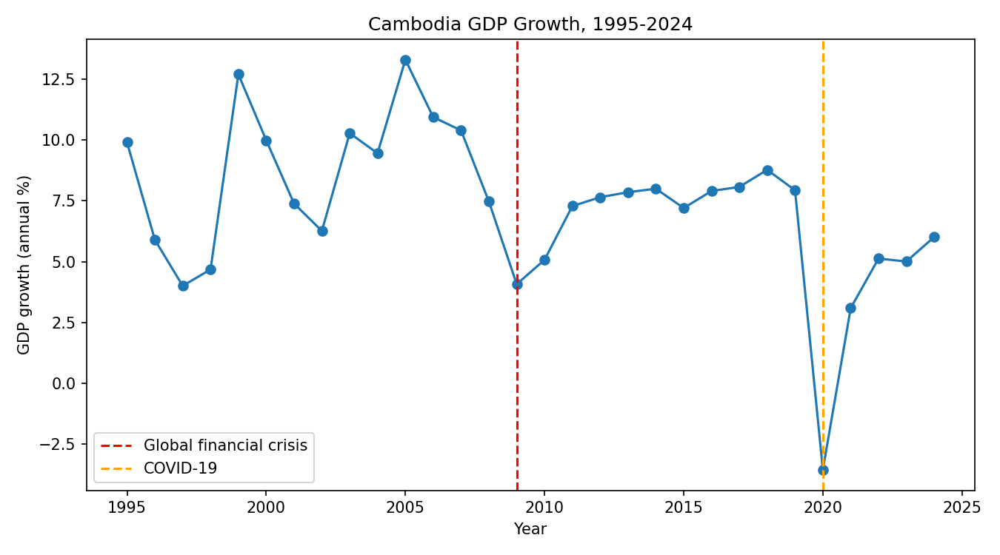

# Cambodia Economic Trends (1995-2024)

## Question
How has Cambodia's economy and development changed since the mid-1990s, and what effect did shocks such as the 2008-09 global financial crisis and COVID-19 have on growth?

## Data
World Bank Open Data (https://data.worldbank.org), country code `KHM`.

| Indicator code | Meaning |
|---|---|
| NY.GDP.MKTP.KD.ZG | GDP growth (annual %) |
| FP.CPI.TOTL.ZG | Inflation, consumer prices (annual %) |
| NY.GDP.PCAP.CD | GDP per capita (current US$) |
| SE.PRM.ENRR | School enrollment, primary (% gross) |
| SP.POP.TOTL | Total population |

## Methods
- Descriptive statistics
- Comparison of average GDP growth across three periods
- Correlation matrix
- Simple linear regression of GDP per capita on year

## How to run
```bash
pip install -r requirements.txt
python scripts/01_download.py
python scripts/02_analysis.py
```

## Key findings
_Fill this in after running the analysis. Add 2-3 findings and embed your charts, for example:_



## Limitations
- Some indicators have missing years
- National aggregate data hides differences between regions and groups
- Correlation does not mean causation
- GDP per capita in current US$ is affected by inflation and exchange rates

## Author
Your Name, Applied Statistics student, Cambodia
